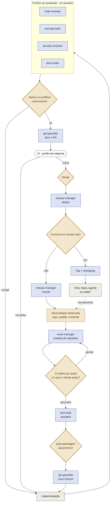

# O processo

## Para que serve este documento

O kit tem três documentos e eles não se sobrepõem:

| Documento | Responde | Para quem |
|---|---|---|
| `README.md` | **Como implanto isso?** Passo a passo, comandos, ordem | Quem está começando um projeto |
| `CLAUDE.md` + `.claude/rules/` | **Quais são as regras?** | Os agentes, em toda sessão |
| **`PROCESS.md`** (este) | **Como esse time funciona, e por quê?** | Quem precisa entender o modelo antes de confiar nele |

Este é o documento que você lê **antes** de adotar o método, e o que entrega a
outra pessoa quando ela pergunta "mas como é trabalhar assim?". Ele descreve o
processo como uma organização: quem faz o quê, o que cada papel entrega ao
próximo, e onde a automação encontra seu limite.

Também é o documento que envelhece mais devagar. As regras mudam com o projeto;
o modelo de papéis, não.

---

## 1. Você não é o desenvolvedor. É o Condutor.

Se cada agente é uma pessoa com uma função, sobra a pergunta: qual função é a sua?

Não é escrever código. Os especialistas não têm acesso ao mundo fora do
repositório — eles leem código, não conversam com o cliente. Isso concentra em
você quatro funções que **não são delegáveis**:

**1 · Fonte da verdade externa.** Só você fala com o cliente, vê o equipamento em
campo, conhece a restrição política, sabe o que foi prometido em reunião. Toda
especificação entra no sistema por você. O que você não trouxer, não existe para
o time.

**2 · Decisão.** Agentes recomendam, com o "por que não" de cada alternativa
descartada. Quem escolhe é você, porque quem responde pela consequência é você.
Recomendação aceita sem leitura não é delegação — é abdicação.

**3 · Validação no mundo real.** O agente lê o diff e confirma que a lógica fecha.
Ele não sente que o fluxo ganhou um passo a mais, não vê o dispositivo em campo
deixar de responder, não percebe que a tela ficou lenta na rede do cliente.

**4 · Aceite.** Declarar "pronto" é um ato de responsabilidade, não uma
verificação. Nenhum portão automático substitui alguém assumindo que aquilo pode
ir para produção.

> **A regra que decorre disso**: toda etapa que **não** depende de uma dessas
> quatro funções é, em princípio, automatizável. Toda etapa que depende de uma
> delas, não é — e insistir só produz a aparência de automação, com a
> responsabilidade solta.

---

## 2. O ciclo por demanda

Uma volta por feature, correção ou ajuste. É este o trecho que roda dezenas de
vezes por mês, e portanto o que vale automatizar.



**Cinco portões humanos por volta.** Nenhum deles é revisão de código — são os
pontos em que alguém precisa responder por uma escolha.

---

## 3. As fases

A fase 0 roda uma vez por projeto. As fases 1 a 7 rodam uma vez por demanda — e a
7 é a que faz o processo melhorar sozinho.

### Fase 0 · Enquadramento — *uma vez por projeto*

Você traz a necessidade, o contexto do cliente e as restrições de operação.
`stack-advisor` converte em escolha de stack, separando o que é caro de desfazer
do que é barato. `git-specialist` monta repositório, branches e a taxonomia de
labels. `docs-writer` abre a documentação por público.

**Portão** · você confirma que as restrições declaradas são as reais, e assume a
decisão de stack.
**Entra**: necessidade e contexto · **Sai**: decisão `0001`, repo, labels

### Fase 1 · Entrada de demanda — *por demanda*

Você traz o que o cliente pediu, o bug que apareceu ou a fricção que observou.
`issue-manager` transforma em issue: título que descreve o sintoma, critério de
aceite verificável, taxonomia aplicada.

**Portão crítico** · o critério de aceite escrito pelo agente é o que o cliente
realmente pediu? Um agente escreve critérios plausíveis com facilidade — e
plausível não é o mesmo que correto. É o portão mais barato do processo e o que
mais custa quando é pulado.
**Entra**: pedido, sintoma · **Sai**: issue rotulada

### Fase 2 · Decisão técnica — *condicional*

Só acontece quando há mais de um caminho possível. `tech-lead` apresenta no máximo
três opções, cada uma com o que custa e onde quebra, e recomenda uma com o critério
explícito.

**Portão** · você decide. Se a decisão vale mais que a tarefa, vira registro em
`.claude/decisions.md` com gatilho de revisão.
**Entra**: issue · **Sai**: abordagem decidida

### Fase 3 · Execução — *por demanda*

`git-specialist` cria a branch a partir de `dev`. A implementação acontece — é o
único ponto do ciclo onde pessoa e agente trabalham no mesmo artefato ao mesmo
tempo. Sem portão; o controle vem depois.

**Entra**: abordagem · **Sai**: diff em branch

### Fase 4 · Portões de qualidade — *por demanda, em paralelo*

Quatro especialistas leem o mesmo diff com vieses diferentes e **sem se
consultar** — o que é vantagem, não desperdício. `code-reviewer` busca corretude,
`test-specialist` busca o que não está protegido, `security-reviewer` busca abuso,
`docs-writer` busca o que a documentação passou a mentir.

**Portão** · cada parecer é aplicado ou **justificado por escrito no PR**. A
justificativa registrada é o que substitui a discussão com um colega, e o que
deixa rastro de quem decidiu ignorar o quê.
**Entra**: diff · **Sai**: 4 pareceres + correções

### Fase 5 · Integração — *por demanda*

`git-specialist` abre o PR com corpo preenchido, vínculo com a issue e o bump de
versão dentro da branch. A CI roda — o único portão que não é nem agente nem
pessoa: é máquina, e o veredito é binário.

**Portão** · você faz o merge. A CI verde **autoriza**; ela não decide.
**Entra**: branch revisada · **Sai**: merge + versão

### Fase 6 · Entrega — *por lote de versões*

`release-manager` conduz o deploy, com backup e plano de reversão prontos antes de
começar.

**Portão intransferível** · você verifica no mundo real: o equipamento respondeu,
o usuário concluiu a tarefa, a rede do cliente aguentou. Nenhum agente alcança
este ponto. Se falhar, reverter vem antes de entender.
**Entra**: versão em `main` · **Sai**: sistema no ar + tag

### Fase 7 · Aprendizado — *por evento*

A fase que quase todo desenho de processo esquece: **o processo se altera a si
mesmo**. Incidente, atrito repetido ou padrão que apareceu três vezes entram aqui
e saem como regra nova, agente promovido da referência, ou nada.

**Portão** · você aprova a mudança de regra. Nenhum agente altera as próprias
instruções sem aprovação — é o que impede o conjunto de crescer sozinho até virar
peso morto.
**Entra**: incidente, atrito · **Sai**: regra, agente ou nada

---

## 4. O organograma

Cada agente tem um equivalente humano reconhecível. É isso que torna o modelo
explicável para quem nunca trabalhou assim.

| Agente | Equivalente humano | Recebe | Entrega |
|---|---|---|---|
| `stack-advisor` | Arquiteto de soluções | Necessidade e restrições | Stack decidida e registrada |
| `issue-manager` | Analista de requisitos | Pedido em linguagem de negócio | Issue com critério de aceite |
| `tech-lead` | Arquiteto de software | Issue | Opções e recomendação |
| `git-specialist` | Engenheiro de plataforma | Intenção em linguagem comum | Branch, PR, tag, repo saudável |
| `code-reviewer` | Revisor de par | Diff | Parecer por severidade |
| `test-specialist` | Analista de qualidade | Diff + critério de aceite | Lacunas e casos de teste |
| `security-reviewer` | Pentester | Diff | Cadeias de exploração |
| `docs-writer` | Redator técnico | Diff + mudança de comportamento | Doc por público, changelog |
| `release-manager` | Engenheiro de operação | Versão aprovada | Sistema no ar, ou revertido |
| `orchestrator` | Coordenador | Múltiplas demandas | Sequenciamento e portões |

### Os artefatos são a interface

Nenhum papel conversa com outro. Cada um lê um artefato durável e produz outro:

```
necessidade → issue → branch → diff → pareceres → PR → merge+versão → tag → doc
```

É exatamente isso que torna o processo pausável, auditável e, no limite,
automatizável. Um processo que depende de conversa não se automatiza — não há o
que ler nem o que escrever. Um processo em que cada troca é um artefato
versionado já é uma máquina de estados: cada etapa tem entrada definida, saída
definida e condição de avanço. Falta apenas quem execute.

---

## 5. Onde a automação para

| Etapa | Natureza | Automatizável? | O que trava |
|---|---|---|---|
| **Fase 4** — Portões de qualidade | Ler diff, produzir parecer | **Autônoma** | Nada. Melhor candidato: alto volume, entrada e saída definidas |
| **Fase 5** — Integração | Abrir PR, rodar CI | **Autônoma**, exceto merge | O merge assume risco |
| **Fase 3** — Execução | Escrever código | **Autônoma** | Só funciona porque a fase 1 fixou o critério e a fase 4 verifica depois |
| **Fase 1** — Entrada de demanda | Traduzir pedido em issue | **Proposta** | Só quem falou com o cliente sabe se os critérios estão certos |
| **Fase 2** — Decisão técnica | Comparar opções | **Proposta** | Recomendar é do agente; assumir a consequência não é |
| **Fase 7** — Aprendizado | Propor mudança de regra | **Proposta** | Regra que se altera sozinha deixa de ser regra |
| **Fase 0** — Enquadramento | Levantar restrições reais | **Humana** | As restrições estão no cliente e na operação, não no repositório |
| **Fase 6** — Validação no real | Confirmar que funciona | **Humana** | Exige contato com o mundo físico e alguém que assuma o aceite |

### Ordem prática de automatizar

1. **Fase 4 primeiro.** Maior volume, mais repetitivo, resultado mais objetivo.
   Disparar os quatro pareceres a cada push já elimina a etapa manual mais
   frequente do ciclo.
2. **Depois a fase 5**, até a CI. O PR se monta a partir da issue e do diff; o
   merge continua sendo seu.
3. **Depois 1, 2 e 7 como fila de aprovação.** O agente produz, você aprova ou
   ajusta. Isso não reduz o número de decisões — reduz o tempo entre elas.
4. **As fases 0 e 6 permanecem.** Não por limitação técnica, e sim porque
   automatizar responsabilidade é uma contradição.

**O piso**: cinco portões por volta. Trazer a necessidade, confirmar o critério de
aceite, escolher a abordagem, autorizar o merge, validar no mundo real. É estável
porque não decorre da capacidade dos agentes, e sim de onde está a
responsabilidade.

---

## 6. O que ainda não foi provado

Honestidade sobre os limites da evidência, para que este documento seja revisado
com base em resultado e não em fé:

- **O método tem uma validação, não uma amostra.** Um sistema em produção com
  usuários e equipamentos reais é evidência real — mas é um caso, de um domínio,
  com um responsável. Não sabemos ainda o que ele exige de diferente em outro
  contexto.
- **Não foi testado com mais de uma pessoa conduzindo.** Todo o desenho assume um
  Condutor. Com dois, aparece um problema que este processo não resolve: quem
  decide quando eles discordam.
- **A revisão por agente ainda não foi medida contra revisão humana.** Sabemos que
  ela pega defeito; não sabemos o que ela deixa passar que um colega pegaria.
- **A fase 7 depende de disciplina.** É a única sem portão automático de entrada:
  se ninguém trouxer o incidente para cá, o processo para de aprender e ninguém
  percebe.

Quando o método for aplicado a um segundo projeto, este é o capítulo que deve
mudar primeiro.

---

*Modelo derivado do uso real do kit. As fases descrevem o ciclo; as regras
executáveis estão em `CLAUDE.md` e `.claude/rules/`.*
